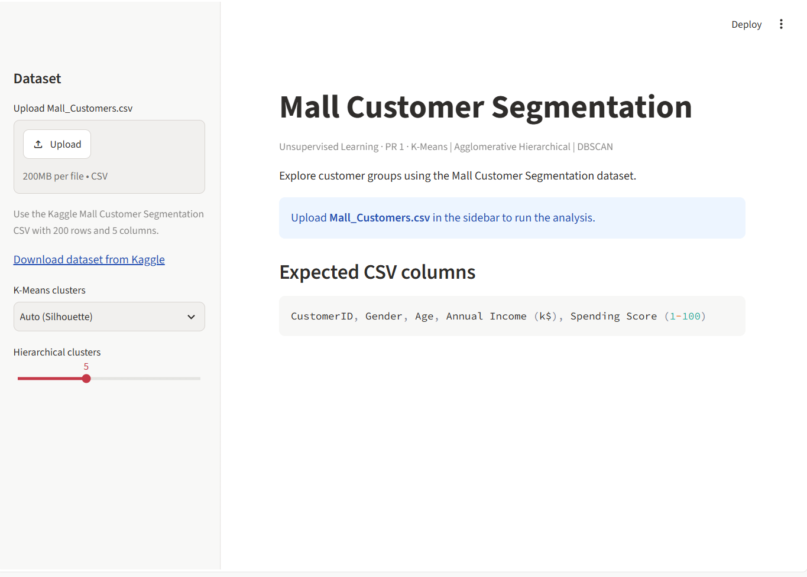

# Mall Customer Segmentation — Unsupervised Learning PR-1

A Streamlit dashboard for exploring customer groups in the Mall Customer Segmentation dataset using three unsupervised learning algorithms:

- **K-Means**
- **Agglomerative Hierarchical Clustering**
- **DBSCAN**

The app includes exploratory data analysis (EDA), feature scaling, cluster visualisations, cluster profiles, evaluation metrics, and business insights.

## Project Preview



*The supplied screenshot shows the dashboard's initial state before a CSV is uploaded. Upload `Mall_Customers.csv` in the sidebar to display the analysis and clustering results.*

## Directory Structure

```text
PR1_Mall_Customer_Segmentation/
│
├── main.py                         
├── model.py                        
├── requirements.txt                
├── .gitignore                      
│
├── data/
│   └── Mall_Customers.csv         
│
├── screenshots/
│   └── Screenshot 2026-11-24 130720.png
│
├── UL_PR1.ipynb                    
├── UL_PR1.html                    
└── README.md                       
```

## Dataset

**File:** `data/Mall_Customers.csv`

The dataset contains 200 customer records and these columns:

| Column | Description |
|---|---|
| `CustomerID` | Customer identifier |
| `Gender` | Customer gender |
| `Age` | Customer age |
| `Annual Income (k$)` | Annual income in thousand dollars |
| `Spending Score (1-100)` | Spending score from 1 to 100 |

The Streamlit app accepts the dataset through the sidebar CSV uploader. It expects the five column names listed above.

## Features

### 1. Overview & EDA
- Dataset preview and cleaned data summary
- Missing-value check
- Feature distributions
- Pairplot and correlation heatmap
- Standard scaling of numeric features

### 2. K-Means Clustering
- Elbow method
- Silhouette score comparison to help select `k`
- Customer cluster scatter plot and centroids
- Cluster profile summary

### 3. Agglomerative Hierarchical Clustering
- Ward-linkage dendrogram
- Cluster visualisation
- Cluster profiles
- Comparison with K-Means

### 4. DBSCAN
- 4-nearest-neighbour distance plot
- Parameter grid for `eps` and `min_samples`
- Cluster and noise-point visualisation

### 5. Comparison & Insights
- Side-by-side algorithm comparison
- Silhouette Score
- Davies-Bouldin Index
- Calinski-Harabasz Index
- Business insights for mall customer groups
- Downloadable clustered-customer CSV

## Technology Stack

- Python
- Streamlit
- Pandas and NumPy
- Matplotlib and Seaborn
- Scikit-learn
- SciPy
- Jupyter Notebook

## Installation & Setup

### 1. Download or clone the repository

Open the project folder in VS Code.

### 2. Create a virtual environment (recommended)

**Windows:**

```bash
python -m venv venv
venv\Scripts\activate
```

### 3. Install dependencies

```bash
python -m pip install -r requirements.txt
```

### 4. Run the Streamlit application

```bash
streamlit run main.py
```

Streamlit will display a local URL in the terminal. Open that URL in your browser.

### 5. Upload the dataset

In the app's left sidebar, upload:

```text
data/Mall_Customers.csv
```

The dashboard will then calculate and display the EDA, clustering results, charts, and evaluation metrics.

## Run the Practical Notebook

To open the notebook:

```bash
jupyter notebook UL_PR1.ipynb
```

Alternatively, open `UL_PR1.ipynb` directly in VS Code or Jupyter Notebook. The `UL_PR1.html` file is the exported, browser-viewable report.

## Screenshots

Project screenshots are stored in the `screenshots/` directory. Add further screenshots there after uploading the dataset and showing the results of each algorithm. Use relative paths in this README, for example:

```markdown

```

## Notes

- Do not upload your local virtual environment (`venv/`) to GitHub. It is excluded by `.gitignore`.
- Keep the dataset in the `data/` folder for a consistent project layout, even though the app currently asks you to upload the CSV through the sidebar.
- The screenshot included here is the initial app screen; it is not a screenshot of the clustering output.

## Author

**Meet Mehta**

Unsupervised Learning 
